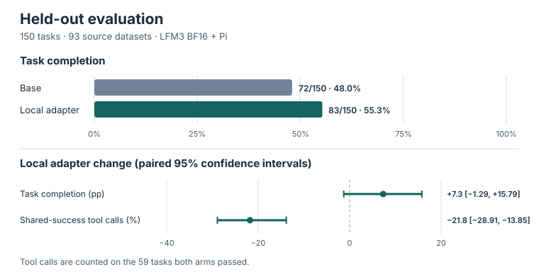

# Local Apple Harness Adapter

Train a LoRA adapter for a specific agent harness on an Apple Silicon Mac. The project runs online reinforcement learning with native MLX inference and training, real Pi or OpenCode sessions, and Harbor tasks with executable verifiers. After downloading the model and preparing the tasks, you can train locally without renting GPUs or paying for inference APIs.

## Results

One **LFM3-1.7B BF16 + Pi** run on an **M4 Max Mac Studio with 128 GB of unified memory** took about **8 hours** for main training and peaked at **35.5 GiB of MLX memory**. Main training used **14 tasks** after warmup, with **400 rollouts** and **41 optimizer updates across 50 groups**. Held-out evaluation covered **150 tasks from 93 source datasets**.

| Metric | Base | Local adapter |
| --- | ---: | ---: |
| Held-out tasks passed | 72/150 | 83/150 |
| Task completion | 48.0% | 55.3% |
| Tool calls on shared successes | 280 | 219 |

Task completion increased by **7.3 percentage points** (95% CI **−1.29 to +15.79 points**). This interval includes zero. On the **59 tasks both arms passed**, the local adapter used **21.8% fewer tool calls** (95% CI for the signed change **−28.91% to −13.85%**). The tool-call result measures invocations. Inference tokens, latency, and total compute cost are separate quantities.



[Experimental evidence and statistics](results/lfm3-pi/README.md) · [Methodology and limitations](docs/methodology.md)

## Supported configurations

| Configuration | Evidence |
| --- | --- |
| LFM3-1.7B BF16 + Pi | Empirically validated configuration for the results above |
| OpenCode | Implemented harness integration with a Docker-backed tool and trace test |
| Qwen3 | Implemented model backend with local pilot training updates and zero passes in both arms of a 24-task coding pilot |
| Inkling 2 Mini | Experimental model backend with local training rehearsals and a cached backward pass |

## Install

Use an Apple Silicon Mac with [uv](https://docs.astral.sh/uv/) and Docker Desktop running. Run from the repository root.

```sh
uv sync --locked --python 3.12 --extra apple --extra harbor
```

The first run downloads the pinned model and builds the task image. Rollouts run in ARM64 containers with networking disabled. Before loading a model, run `memory_pressure -Q`, check for trainers and model weights held by local inference servers, and leave headroom for macOS and Docker. Run one model workload at a time.

## Quick start

Run a file-writing task with Pi. Inspect `runs/pi-smoke/group-0001/metrics.json` for the verifier score and tool-call count.

```sh
uv run --no-sync apple-harness --backend lfm3 harbor --harness pi \
  --task examples/harbor/write-answer --attempts 1 --collect-only \
  --effort low --max-output 768 --output runs/pi-smoke
```

To try OpenCode, use `--harness opencode --task examples/harbor/write-answer-opencode` in place of the Pi harness and task arguments, add `--max-context 6144`, and use a fresh output directory. For a small sampling and LoRA backward-pass check, run `uv run --no-sync apple-harness --backend lfm3 smoke`.

## Train, evaluate, and resume

Use the [SmolDataEnvs recipe](examples/smoldataenvs/README.md) for a one-group pilot, the full training schedule, and paired evaluation. The recipe pins the model and task manifests and verifies the downloaded inputs.

- **Train.** Pass one or more `--task PATH` arguments and set `--steps N` for the number of rollout groups. Omit `--collect-only` and use multiple attempts per group. Equal effective rewards skip the update. Each Harbor task needs an instruction, a verifier that emits a score from 0 to 1, and a `no-network` ARM64 image or Dockerfile with Pi 1.5.2 or OpenCode 1.18.30. SafeAgents reviews tool calls by default.
- **Evaluate.** Use `--collect-only` for both arms and match held-out tasks, seeds, harness, model, and rollout limits. Add `--adapter PATH` to the adapter arm. The example runner handles pairing, arm order, and the summary.
- **Resume.** After the previous trainer exits, repeat the training command with `--resume`, the same output directory, and matching settings. You can increase `--steps`. Keep the group metrics, adapter directories, and `training.safetensors` files so the runner can restore the latest committed adapter, Adam state, and sampling key.

## Research context

This project builds on Hugging Face's [harness-adapter experiments](https://huggingface.co/blog/harness-hub/harness-adapters) and [harness adapters at scale](https://huggingface.co/blog/harness-adapters-at-scale). It implements their harness-specific training recipe with sequential, on-policy MLX LoRA updates on one Mac. [Upstream attribution and implementation details](docs/methodology.md)

Project code is [Apache-2.0](LICENSE). Models and datasets retain their upstream terms. [Third-party notices](THIRD_PARTY_NOTICES)
