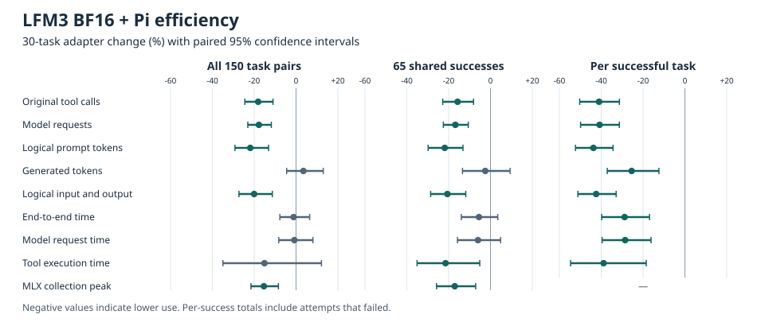

# 30-task adapter efficiency

On 150 held-out tasks the 30-task adapter solved **100**, compared with **72** for base, **83** for the 14-task adapter, and **100** for the published Harness Hub adapter. It used **20.04% fewer logical tokens than base** and **42.43% fewer logical tokens per success**, including the resources spent on failed tasks. Against the published adapter, the 30-task adapter reached the same pass count while using **12.95% more logical tokens**. [Accuracy and original tool-call comparisons](summary.json)



## Compared with base

Totals include all attempts in each cohort. The allocator row compares means of per-attempt MLX collection peaks. Intervals are paired 95% source-dataset bootstrap intervals.

| Metric | All 150 tasks | 65 shared successes |
| --- | --- | --- |
| Logical prompt tokens | 2,434,674 → 1,902,144 · −21.87% [−29.20%, −13.13%] | 1,013,648 → 791,982 · −21.87% [−29.81%, −13.14%] |
| Generated completion tokens | 189,026 → 195,670 · +3.51% [−4.49%, +13.01%] | 71,450 → 69,676 · −2.48% [−13.38%, +9.38%] |
| Logical input and output tokens | 2,623,700 → 2,097,814 · −20.04% [−27.29%, −11.34%] | 1,085,098 → 861,658 · −20.59% [−28.61%, −11.81%] |
| Requests reaching the model endpoint | 901 → 741 · −17.76% [−23.05%, −11.82%] | 393 → 327 · −16.79% [−22.53%, −10.61%] |
| Agent turns delivered by the model | 868 → 729 · −16.01% [−21.93%, −9.39%] | 393 → 327 · −16.79% [−22.53%, −10.61%] |
| Original tool calls | 740 → 606 · −18.11% [−24.48%, −11.01%] | 318 → 268 · −15.72% [−22.83%, −8.09%] |
| Actual Pi tool executions | 767 → 615 · −19.82% [−26.09%, −12.85%] | 330 → 272 · −17.58% [−24.32%, −10.34%] |
| End-to-end time, s | 4,397.16 → 4,346.13 · −1.16% [−7.73%, +6.49%] | 1,719.62 → 1,625.12 · −5.50% [−13.95%, +3.48%] |
| Model request time, s | 3,601.461 → 3,573.242 · −0.78% [−8.27%, +8.07%] | 1,388.473 → 1,305.492 · −5.98% [−15.80%, +4.85%] |
| Tool execution time, s | 135.256 → 114.849 · −15.09% [−34.96%, +12.15%] | 48.218 → 37.868 · −21.47% [−35.09%, −5.12%] |
| Mean MLX collection peak, GiB | 10.969 → 9.282 · −15.38% [−21.52%, −8.42%] | 11.224 → 9.308 · −17.08% [−25.79%, −7.09%] |

Per success, logical prompt use fell **43.75%** (95% CI **−52.32% to −34.37%**), from 33,815 to 19,021 tokens. Generated use fell **25.47%** (95% CI **−37.13% to −12.42%**), from 2,625 to 1,957 tokens. The combined ratio was **36,440 → 20,978 tokens** (−42.43%, 95% CI **−51.17% to −32.87%**). Recorded elapsed time per success was **61.07 → 43.46 seconds** (−28.84%, 95% CI **−39.80% to −16.93%**). Total time across the holdout was similar, so the improvement in recorded time per success comes primarily from the higher pass count. [Full results including means, medians, percentiles, totals, and uncertainty](efficiency.json)

## Compared with both Pi adapters

Each change is relative to the named reference. The 30-task adapter improved the logical-token and elapsed-time ratios per solve relative to the 14-task adapter. On the tasks both local adapters solved, the 30-task adapter made more original tool calls. Against the published adapter, equal pass counts came with more generated tokens, more tool calls, and higher recorded elapsed time.

| Metric | vs. 14-task adapter | vs. published Harness Hub adapter |
| --- | --- | --- |
| Logical tokens, all tasks | −6.48% [−12.79%, −0.04%] | +12.95% [+3.63%, +23.58%] |
| Generated tokens, all tasks | −5.99% [−12.59%, +1.21%] | +23.26% [+12.78%, +35.13%] |
| Recorded elapsed time, all tasks | −5.74% [−11.02%, −0.14%] | +13.22% [+2.66%, +23.83%] |
| Logical tokens, shared successes | +2.52% [−4.16%, +9.36%] on 72 tasks | +17.52% [+10.14%, +25.32%] on 88 tasks |
| Original tool calls, shared successes | +7.84% [+0.87%, +15.05%] | +27.43% [+18.56%, +36.90%] |
| Logical tokens per success | −22.38% [−32.37%, −11.71%] | +12.95% [+1.52%, +25.19%] |
| Recorded elapsed time per success | −21.76% [−31.98%, −10.42%] | +13.22% [+0.27%, +27.10%] |

The 30-task arm ran later in a separate worker. The three reference arms share an earlier interleaved run. The bootstrap pairs task outcomes and cannot remove worker, time-of-day, allocator-state, or other run effects. Treat runtime and memory differences as measurements of these runs. Logical tokens measure prompt and sampled positions, and device time, energy, and cache-adjusted compute remain unmeasured. [Metric definitions and statistical method](../lfm3-pi/efficiency.md)

## Archive coverage and reproduction

The broader archive is `runs/lfm3-breadth/` with 150 new attempt directories in `evaluation/<task>/broad/`. The evaluator reuses the reference outcomes from `runs/lfm3-150/`. The extraction reconciled `measurement.json`, group metrics, the OpenEnv attempt, Harbor result and ATIF records, and the Pi session for each arm. The broader OpenEnv export retained 720 model responses. Pi recorded nine additional responses. Four context-clipped requests supplied 22,995 prompt tokens and 1,581 completion tokens through verified tokenizer replay. Eight over-context requests had recorded rendered lengths and never sampled. The proxy stopped one request at the model-call limit. All 150 rows have request time, tool time and MLX collection peak measurements.

Full reasoning totals are available on 137 broader attempts. On the **110 complete pairs versus base**, the 30-task adapter used **19.66% more** reasoning tokens (95% CI +4.59% to +37.91%). The complete-pair changes are **−0.15%** [−11.84%, +13.06%] versus the 14-task adapter and **+44.62%** [+28.25%, +63.35%] versus the published adapter, each on 112 pairs. Per-success reasoning totals are unavailable because some responses lack sampled token IDs. Both archives were analyzed with the same 93 source clusters, 10,000 draws and seed 8921. [New and published-arm numeric rows](efficiency-pairs.jsonl) · [Base and 14-task numeric rows](../lfm3-pi/efficiency-pairs.jsonl)

```sh
PYTHONPATH=src python3 results/lfm3-pi-breadth/analyze.py --efficiency --check
PYTHONPATH=src .venv/bin/python results/lfm3-pi-breadth/analyze.py \
  --archive runs/lfm3-breadth --reference-archive runs/lfm3-150 \
  --tokenizer-snapshot "$LFM3_TOKENIZER_SNAPSHOT" --check
```

The first command uses released numeric data only. The second uses both original archives and the [pinned local tokenizer snapshot](../lfm3-pi/efficiency.md#reproduce). Use `--write` instead of `--check` to regenerate release files.
