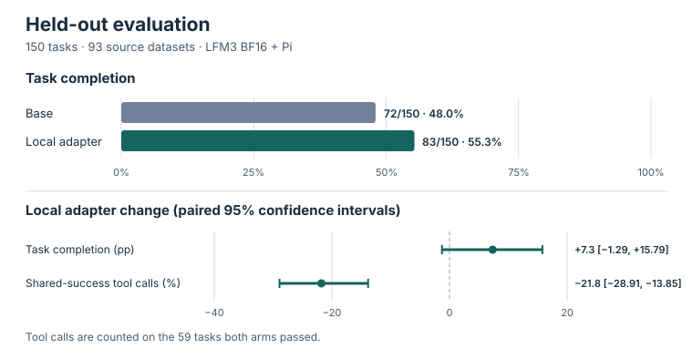
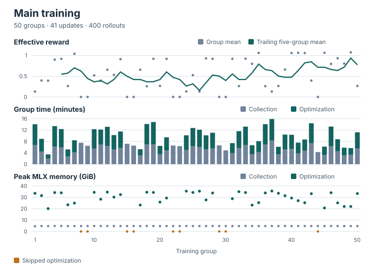

# LFM3-1.7B BF16 + Pi results

On 150 held-out SmolDataEnvs tasks, the local adapter passed 83 tasks and the base model passed 72. The difference was **+7.33 percentage points** (paired 95% CI **−1.29 to +15.79 points**), which includes zero. Across 59 shared successes, tool calls fell from 280 to 219, a signed change of **−21.79%** (paired 95% CI **−28.91% to −13.85%**).

Across all 150 tasks the adapter used **14.50% fewer logical input and output tokens** while generating **10.11% more completion tokens**. End-to-end attempt time rose **4.86%**, with a confidence interval spanning zero. [Efficiency results, definitions, and regeneration](efficiency.md)



The original evaluation also included the published Harness Hub Pi adapter, converted to the local MLX tensor layout. It passed **100/150** tasks. The full summary includes all arm comparisons, including **+18.67 points** for published versus base (95% CI **+10.53 to +26.62**) and **−11.33 points** for local versus published (95% CI **−18.71 to −4.03**). Joint-success tool-call comparisons use the intersection of passes for their respective pair of arms. The published checkpoint has a different training history. [Upstream adapter](https://huggingface.co/harness-hub/LFM3-1.7B-pi) · [Full summary](summary.json)

## Evidence

| File | Contents |
| --- | --- |
| [pairs.jsonl](pairs.jsonl) | One row per task in original evaluation order with its source cluster, seed, arm order, task digest, and numeric measurements for all three arms |
| [summary.json](summary.json) | Original evaluation aggregate with all pairwise comparisons and full-precision confidence intervals |
| [efficiency-pairs.jsonl](efficiency-pairs.jsonl) | Base and local adapter tokens, requests, turns, tool calls, time, MLX collection peaks, and capture coverage per task |
| [efficiency.json](efficiency.json), [efficiency.svg](efficiency.svg) | Aggregate resource use, distributions, source-dataset bootstrap intervals, and paired comparisons |
| [training.jsonl](training.jsonl) | Three warmup and 50 main group records, including per-attempt verifier scores, effective rewards, tool counts and safety counts, plus group timing, peak memory, and update diagnostics |
| [provenance.json](provenance.json) | Training and evaluation settings, original artifact hashes, model and dataset revisions, seeds, and evaluated adapter hashes |
| [heldout.svg](heldout.svg), [training.svg](training.svg) | Figures drawn from the released summary and group measurements |

The 50 main groups account for **4 h 26 min 37 s** of collection and **3 h 26 min 36 s** of optimization. The recorded main phase wall time was **7 h 53 min 27 s**. The 35.526 GiB peak occurred during optimization. These are MLX allocator peaks. macOS, Docker, and other processes also need memory. The reward curve mixes tasks and is a descriptive record of the training schedule. Skipped groups have equal effective rewards and omit update-only diagnostics.



## Regenerate the reported statistics

Run from the repository root with Python 3.12 or 3.13. No model, Docker, or additional Python packages are needed for this calculation.

```sh
PYTHONPATH=src python3 results/lfm3-pi/analyze.py --check
PYTHONPATH=src python3 results/lfm3-pi/analyze.py
```

The script reuses the [example runner's analysis](../../examples/smoldataenvs/run.py) to regenerate the paired statistics with 10,000 source-dataset bootstrap resamples. The first command checks all three comparisons against the original aggregate and checks the local comparison against [observed.json](../../examples/smoldataenvs/observed.json). The second writes the regenerated summary to standard output. Pair order matters for reproducing the exact seeded bootstrap draws.

The [SmolDataEnvs recipe](../../examples/smoldataenvs/README.md) stages the same split manifests and repeats training and the base/local comparison with the current runner. The historical evaluation used six rotating three-arm orders and the archived engine hashes in [provenance.json](provenance.json). The current recipe uses two alternating orders and rebuilds task images. It is a procedure for rerunning the experiment. The commands above reproduce the historical statistics from measurements. [Full methodology](../../docs/methodology.md)

The evidence includes public task and source identifiers, hashes, and numeric metrics. The dataset recipe fetches the pinned upstream inputs subject to their original terms. Get the 14-task weights from the [versioned release](https://github.com/brendanboyle87/local-apple-harness-adapter/releases/tag/v0.1.0). See the [30-task follow-up](../lfm3-pi-breadth/README.md) for the recommended checkpoint and the direct comparison.
