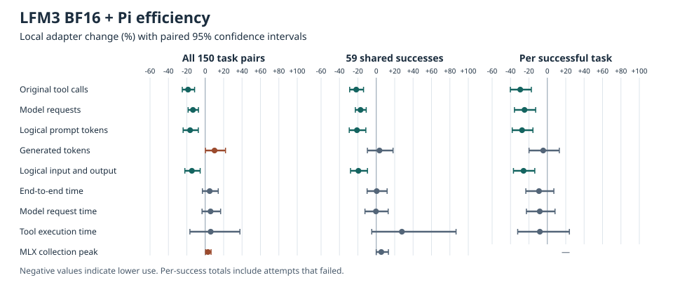

# Held-out agent efficiency

The local adapter used **14.50% fewer logical input and output tokens** across the 150 paired tasks (paired 95% CI **−22.15% to −5.49%**). Prompt use fell **16.42%**, while generated tokens rose **10.11%**. The adapter also made fewer model requests and tool calls. End-to-end elapsed time rose **4.86%** and time per success fell **9.04%**, with both intervals spanning zero. The recorded mean MLX collection peak rose **3.00%**. This evaluation shows a reduction in logical token use and agent actions, with speed and total compute savings still unresolved.

The original accuracy result was **72/150** base passes and **83/150** adapter passes, a change of **+7.33 percentage points** (95% CI **−1.29 to +15.79 points**). The original shared-success tool count remains **280 to 219** (−21.79%, 95% CI −28.91% to −13.85%). [Original three-arm summary](summary.json)



## All tasks and shared successes

Each cell gives the base and local adapter totals, followed by the signed percentage change and its paired 95% interval. The allocator row compares mean per-attempt peaks. The full results include means, medians, standard deviations, p10, p90, p95, extrema, paired task counts with lower, tied, and higher values, and intervals for absolute mean differences. [Machine-readable results](efficiency.json)

| Metric | All 150 paired tasks | 59 shared successes |
| --- | --- | --- |
| Logical prompt tokens | 2,434,674 → 2,035,011 · −16.42% [−24.01%, −7.51%] | 879,371 → 694,851 · −20.98% [−29.38%, −11.35%] |
| Generated completion tokens | 189,026 → 208,144 · +10.11% [+0.19%, +22.03%] | 59,889 → 61,974 · +3.48% [−9.67%, +18.22%] |
| Logical input and output tokens | 2,623,700 → 2,243,155 · −14.50% [−22.15%, −5.49%] | 939,260 → 756,825 · −19.42% [−28.01%, −9.59%] |
| Model requests reaching the endpoint | 901 → 781 · −13.32% [−18.61%, −7.35%] | 345 → 286 · −17.10% [−22.77%, −10.94%] |
| Agent turns delivered by the model | 868 → 768 · −11.52% [−17.70%, −4.49%] | 345 → 286 · −17.10% [−22.77%, −10.94%] |
| Original tool calls | 740 → 602 · −18.65% [−24.93%, −11.56%] | 280 → 219 · −21.79% [−28.91%, −13.85%] |
| Actual Pi tool executions | 767 → 632 · −17.60% [−23.85%, −10.60%] | 288 → 228 · −20.83% [−27.53%, −13.59%] |
| End-to-end time, s | 4,397.16 → 4,610.67 · +4.86% [−3.08%, +14.16%] | 1,466.45 → 1,472.73 · +0.43% [−9.97%, +11.78%] |
| Model request time, s | 3,601.461 → 3,810.123 · +5.79% [−3.45%, +16.73%] | 1,171.383 → 1,166.969 · −0.38% [−12.30%, +12.93%] |
| Tool execution time, s | 135.256 → 143.272 · +5.93% [−16.66%, +37.71%] | 38.127 → 48.738 · +27.83% [−4.93%, +86.71%] |
| Mean MLX collection peak, GiB | 10.969 → 11.298 · +3.00% [+0.42%, +6.36%] | 11.088 → 11.693 · +5.46% [−0.09%, +13.20%] |

All-task elapsed time averaged **29.31 → 30.74 seconds** per task. The median rose from **25.60 to 26.92 seconds**, while p90 fell from **51.86 to 49.88 seconds**. On shared successes, tool execution time medians were **0.594 → 0.597 seconds**. The adapter’s largest tool-time total there was **9.519 seconds**, compared with **1.515 seconds** for the base arm. The per-attempt MLX collection peaks had maxima of **19.354 → 19.927 GiB** across all tasks and **19.184 → 18.942 GiB** on shared successes. [Per-task measurements](efficiency-pairs.jsonl)

## Aggregate resources per success

Each arm’s numerator includes resource use on **all 150 attempts**, including failures. Its denominator is the verifier pass count, **72** for base and **83** for the adapter.

| Metric per success | Base | Local adapter | Change and paired 95% CI |
| --- | ---: | ---: | ---: |
| Logical prompt tokens | 33,814.9 | 24,518.2 | −27.49% [−38.16%, −15.65%] |
| Generated completion tokens | 2,625.4 | 2,507.8 | −4.48% [−19.90%, +13.02%] |
| Logical input and output tokens | 36,440.3 | 27,026.0 | −25.83% [−36.82%, −13.64%] |
| Model requests reaching the endpoint | 12.51 | 9.41 | −24.81% [−35.76%, −12.69%] |
| Original tool calls | 10.28 | 7.25 | −29.43% [−40.22%, −17.37%] |
| End-to-end time, s | 61.07 | 55.55 | −9.04% [−23.38%, +7.09%] |
| Model request time, s | 50.02 | 45.91 | −8.23% [−22.77%, +8.35%] |
| Tool execution time, s | 1.88 | 1.73 | −8.11% [−32.22%, +23.95%] |

The bootstrap uses the original task order, 93 source-dataset clusters, 10,000 resamples, seed 8921, and Python’s exclusive quantiles for the 2.5th and 97.5th percentiles. Each draw keeps both arms and all tasks in every sampled source. The shared-success calculation applies the joint-pass filter within each draw. The per-success calculation recomputes both resource and pass totals within each draw. Draws with undefined denominators are omitted. The intervals are marginal, with no adjustment for multiple comparisons, and reflect source-dataset resampling of one stochastic rollout per arm. Shared successes are an outcome-selected group. [Original evaluation methodology](../../docs/methodology.md#reference-experiment)

## Artifact inventory and metric definitions

The original local archive is `runs/lfm3-150/`. It contains `plan.json`, the frozen worker and engine, `evaluation.log`, the final `results.json`, and the original `evaluation/pairs.json` and `evaluation/summary.json`. All 450 attempt directories under `evaluation/<task>/<arm>/` contain `measurement.json`, a rollout config, and `group-0001/` with `metrics.json`, the OpenEnv `attempt-01.json`, and a Harbor trial. Each trial includes Harbor `result.json`, ATIF `agent/trajectory.json`, Pi `agent/pi/sessions/*.jsonl`, `agent/pi.txt`, and verifier artifacts. There were no infrastructure retry or interrupted-arm directories, agent timeouts, or SafeAgents blocks in this archive. The release records the three-arm run duration separately from the sum of individual attempt durations. [Frozen provenance](provenance.json)

| Measurement | Historical source and coverage |
| --- | --- |
| **Logical prompt and completion tokens** | Sum the model’s rendered prompt length and returned sampled completion IDs for each generation request, including repeated context, delimiters, sampled stop IDs, verifier failures, and generated responses omitted from the OpenEnv training export. Pi per-response usage agrees with Harbor’s ATIF and agent usage. Prompt replay recovers the split for context-clipped responses as described below. |
| **Rendered prompt tokens** | Logical prompt tokens plus the prompt lengths in explicit over-context rejection warnings. The endpoint tokenized these requests and rejected them before model sampling. Rejected prompts added 518,390 rendered tokens for base and 28,045 for the adapter. The model-call limit stops earlier, at the proxy. |
| **Requests and agent turns** | `pi_requests` includes Pi requests ending in budget replies. `model_requests` counts backend requests including over-context rejections. `generation_requests` counts requests that sampled tokens, including clipping. `agent_turns` counts model-generated assistant messages delivered to Pi, including those omitted by the training export. In all 150 pairs these totals are respectively 907/782, 901/781, 876/777, and 868/768. |
| **Tool calls and executions** | The original count uses tool calls on retained agent turns in OpenEnv. Pi tool-call IDs match tool results and SafeAgents verdicts, and Harbor ATIF agrees on the counts. Pi logged 768/632 tool calls. One base call failed argument validation before execution. Pi records executions separately with `durationMs`. |
| **End-to-end task duration** | The worker’s monotonic `measurement.seconds` tracks each attempt through Harbor setup, agent, verifier, teardown and collection bookkeeping through the group commit. The worker applies the arm weights before this timer starts. Harbor `result.json` timestamps also cover the trial and agent phases, OpenEnv stores `wall_s`, and group metrics store the collection duration. |
| **Model request duration** | Sum Pi’s monotonic assistant-stream `durationMs` for requests that sampled tokens. This includes the requests whose generated response was replaced by a context stop. The interval includes tokenization, MLX execution, SafeAgents, relay, proxy and response handling. Pure inference, prefill and decode time are unavailable. |
| **Tool execution duration** | Sum Pi tool-result `durationMs` around the tool’s execution, including executions that return errors. The lone argument validation failure occurred before the tool timer starts and contributes no execution. The sum measures call durations, and concurrent calls could overlap in elapsed time. |
| **Peak MLX allocation** | `collection_peak_mlx_gib` in the single-attempt group metrics, copied into `measurement.json`. This is the MLX allocator high-water mark during collection in the resident evaluation worker. It includes live allocations outside an individual inference request. Process-wide memory, system unified memory and isolated inference peaks were unmeasured. |
| **Reasoning tokens** | The pinned tokenizer identifies tokens between the prompt’s implicit opening marker and the first sampled closing marker, or up to the returned completion boundary, excluding a terminal stop ID. The audit verifies the decoded region against Pi’s thinking text on all retained completions. Full attempt totals are `null` where IDs are missing. Pi’s reasoning usage field is zero throughout because the endpoint provided no separate reasoning count. |

### Recovering tokens from omissions and budget stops

The OpenEnv training export retained **840 base and 738 adapter** generations. The Pi session usage adds **28 base and 30 adapter** responses omitted by that export, including the work on discarded branches. Raw token IDs are available for the retained turns. The build checks those IDs against Pi usage and verifies that the sums of OpenEnv’s training-target tokens are separate from inference use. These training-target totals are **174,034 base and 190,140 adapter**, compared with **189,026 and 208,144** generated tokens overall.

OpenEnv emitted synthetic budget replies with zero usage after three different events. At the model-call limit (6 base, 1 adapter), the proxy returned before sending the request to MLX. With an over-context prompt (25 base, 4 adapter), the endpoint returned HTTP 400 after rendering the prompt and before generation. With a **context-clipped response** (8 base, 9 adapter), the endpoint generated to the available window, then OpenEnv replaced the response before exporting it or returning it to Pi. The Pi stream timer still covered that request.

For clipped responses, the analysis appends the recorded Pi assistant and tool messages to the preceding captured request, using that request’s tools and the pinned chat template and tokenizer. Across all three historical arms it checks all **2,198** original captured prompt ID arrays, reproduces **1,748** follow-up captured prompt arrays from prior messages, and matches the independently recorded prompt lengths for **80** discarded responses and **41** over-context rejections. The frozen endpoint returns `length` when it samples to its limit. OpenEnv recognizes a context clip when that count is below the requested output cap, which the proxy already capped at 1,024. For these responses the binding limit is the remaining context, so **completion length equals 6,144 minus the reconstructed prompt length**. The extraction adds these counts for all 28 clipped responses during its audit and exports the 17 from the comparison arms. Replay uses the tokenizer and recorded traces.

Full reasoning-token counts are available in **99 of the 150 pairs**, including **45 of the 59 shared-success pairs**. On the 99 complete pairs, the adapter generated **19.28% more reasoning tokens** (95% CI **+1.65% to +42.68%**). On the 45 complete shared-success pairs the change was **+12.60%** (95% CI **−8.21% to +36.34%**). The selection depends on capture coverage, and this comparison cannot establish the overall reasoning-token change. The machine-readable per-success reasoning result is `null`.

### Logical token counts and compute

The historical sampler passed each rendered prompt to MLX-LM with a fresh generation cache. The pinned MLX-LM implementation prefills each prompt and uses that cache within the request during decoding. No cross-request cache reuse is configured in this run. Pi’s zero cache counters carry no independent runtime measurement. Logical input tokens measure submitted context for sampled requests, including the same tokens each time that context is presented. They do not weight prefill and decode by cost or measure a cache hit, device time, FLOPs, energy, or MLX-LM’s asynchronous look-ahead work. The benchmark does not establish a reduction in any of those quantities.

## Reproduce

From the repository root, check the original results, the new paired aggregates and the figure from the released numeric data. Python 3.12 or 3.13 plus the repository source is sufficient.

```sh
PYTHONPATH=src python3 results/lfm3-pi/analyze.py --efficiency --check
```

For a raw audit, use the original `runs/lfm3-150` directory and the locally cached pinned tokenizer snapshot. This step uses the `transformers` tokenizer available in the locked project environment. The extractor verifies the input hashes and reads only tokenizer assets, traces, and metadata. Define `LFM3_TOKENIZER_SNAPSHOT` as the path to the pinned snapshot directory containing `tokenizer.json`, `tokenizer_config.json`, and `chat_template.jinja`.

```sh
PYTHONPATH=src .venv/bin/python results/lfm3-pi/analyze.py \
  --archive runs/lfm3-150 --tokenizer-snapshot "$LFM3_TOKENIZER_SNAPSHOT" --check
```

Use `--write` in place of `--check` to regenerate the release files. Without an archive, `--efficiency --write` rebuilds the aggregate and figure from the released per-task rows. Published rows contain task and source IDs, seeds, and numeric measurements. [Analysis entry point](analyze.py) · [Archive extraction and statistics](efficiency.py)

## README and model card recommendations

Keep accuracy and shared-success tool calls as context. Add **logical input and output tokens per success** (−25.83%, 95% CI −36.82% to −13.64%) and **generated completion tokens across all tasks** (+10.11%, 95% CI +0.19% to +22.03%). Pair these with **end-to-end time per success** (−9.04%, 95% CI −23.38% to +7.09%) and its uncertainty. In the model card’s hardware section, describe the existing **19.927 GiB** figure as the maximum MLX collection peak of the historical evaluation. Link to the paired memory, requests, tool timing, and reasoning figures here.

## Future evaluation instrumentation

1. Append one numeric record per request at the relay and endpoint, before response rewriting or training-export filtering. Keep an attempt ID, a joinable request ID, terminal status, rendered prompt length, sampled count including stop IDs, whether generation ran, and the reasoning token boundary when the tokenizer identifies it. Record prefill tokens actually processed and reused by the backend when that path exists.
2. Keep monotonic request and phase timing at the endpoint. Use backend events or existing synchronization points to distinguish tokenization, prefill, decode, and postprocessing, and retain the relay or Pi span for end-to-end request latency. Include failed and canceled requests. Collect device timing or energy in explicitly scoped profiling if those comparisons are needed.
3. Preserve the Pi tool span with call ID and execution status, including validation failures and cancellations. Preserve the scope and baseline of MLX allocator peaks, and publish collection peaks separately from request-local peaks and system memory. Log an attempt’s elapsed time and allocator peak even when it fails.

These additions belong in evaluation telemetry and can use the same model, sampling policy, tool harness, verifier, adapter weights, and training objective.
